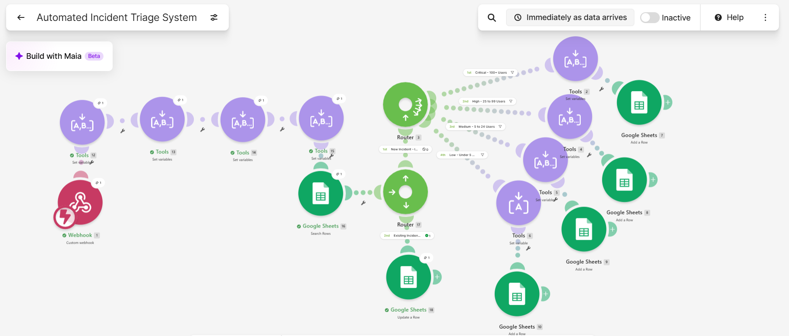
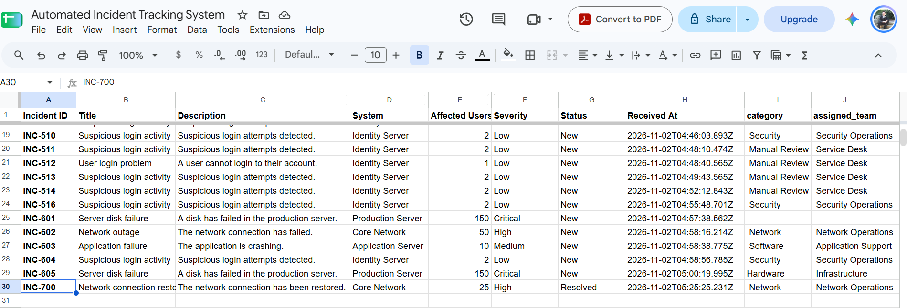
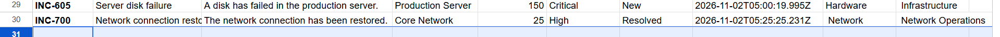

# Automated Incident Triage System

A **rules-based IT incident intake, classification, routing, and tracking workflow** built with Make.com, Google Sheets, and webhook test requests from PowerShell.

## Overview

The workflow receives a JSON incident through a Make.com custom webhook. It assigns a severity based on the number of affected users, uses simple keyword rules to categorize the incident and select a support team, and writes the record to a Google Sheets incident register. On subsequent requests with the same incident ID, it searches for the existing row and updates that record instead of adding another.

This project uses **synthetic test incidents** and is a portfolio demonstration, not a production incident-response system or AI classifier.

## Architecture

```text
PowerShell / JSON test request
          |
          v
Make.com Custom Webhook
          |
          v
Keyword Classification (Tools modules)
  - Category
  - Assigned Team
          |
          v
Google Sheets: Search Rows by Incident ID
          |
          v
Existing vs. New Router
  |                         |
  | Existing                | New
  v                         v
Google Sheets: Update Row   Severity Router
                            | Critical / High / Medium / Low
                            v
                         Google Sheets: Add Row
```

## Classification rules

### Severity (demo thresholds)

| Affected users | Assigned severity |
| ---: | --- |
| 100 or more | Critical |
| 25–99 | High |
| 5–24 | Medium |
| 0–4 | Low |

### Categories and assignments

| Detection keyword in incident description | Category | Assigned team |
| --- | --- | --- |
| `disk` | Hardware | Infrastructure |
| `network` | Network | Network Operations |
| `application` | Software | Application Support |
| `suspicious` | Security | Security Operations |
| No keyword matches | Manual Review | Service Desk |

Classification is based on simple case-normalized substring matching, not semantic understanding. When multiple keywords occur, the outcome depends on the order of the classification modules; the last matching rule can take precedence.

## Spreadsheet schema

| Column | Field |
| --- | --- |
| A | Incident ID |
| B | Title |
| C | Description |
| D | System |
| E | Affected Users |
| F | Severity |
| G | Status |
| H | Received At |
| I | category |
| J | assigned_team |

## Verified test cases

| Incident | Affected users | Severity | Category | Team |
| --- | ---: | --- | --- | --- |
| INC-605: Disk failure | 150 | Critical | Hardware | Infrastructure |
| INC-602: Network outage | 50 | High | Network | Network Operations |
| INC-603: Application crash | 10 | Medium | Software | Application Support |
| INC-604: Suspicious login | 2 | Low | Security | Security Operations |

Duplicate/update behavior was also tested using **INC-700**: an existing incident row was updated to title **Network connection restored** and status **Resolved**, without adding a second row.

## Test input

See [`sample-incident.json`](sample-incident.json) for a synthetic JSON payload. To submit it using PowerShell, assign a private webhook URL in your own terminal and run:

```powershell
$webhookUrl = "YOUR_PRIVATE_MAKE_WEBHOOK_URL"
$body = Get-Content -Raw -Path .\sample-incident.json
Invoke-RestMethod -Uri $webhookUrl -Method Post -ContentType 'application/json' -Body $body
```

**Never commit a real webhook URL, connection credential, access token, or customer incident information.**

## Skills demonstrated

- Webhook intake and JSON data mapping
- Conditional rules and severity-based routing
- Text normalization and keyword classification
- Integrating Make.com with Google Sheets
- Searching for existing records and updating matching rows
- Functional testing, debugging, and regression validation

## Limitations and potential improvements

- Severity is determined only by affected-user count. Real incidents require impact, urgency, service criticality, and security risk assessments. A security incident should not automatically be Low because it affects only two users.
- Keywords are simplistic and may miss synonyms or classify descriptions with multiple keywords unexpectedly.
- Search-then-update is not atomic and may produce duplicates under concurrent submissions.
- The **Received At** field was observed to change on an update during testing; preserve creation timestamps separately from **Last Updated** in a future revision.
- No authentication, monitoring, alerting, retry policy, or access-control hardening is shown here.


## Screenshots

### Automation Workflow


### Incident Classification Results


### Duplicate Prevention and Record Updates

  

## Tools

Make.com · Google Sheets · Windows PowerShell · JSON · GitHub
